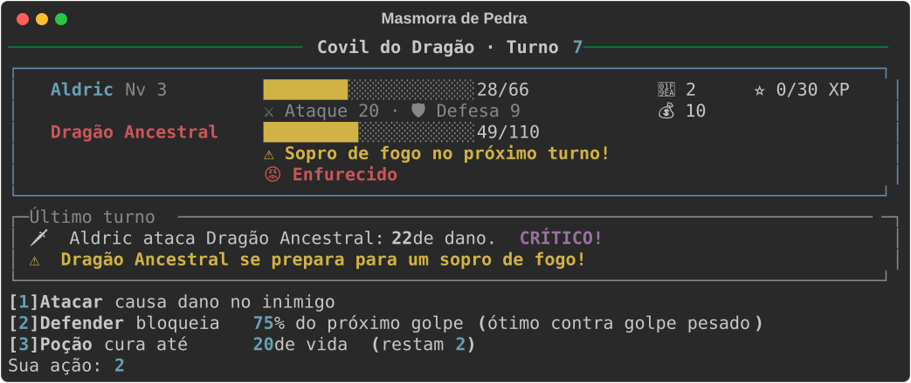
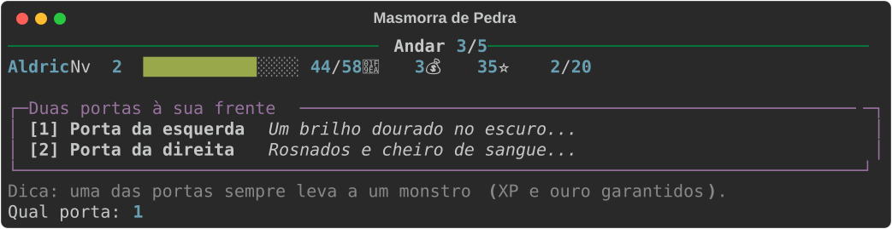
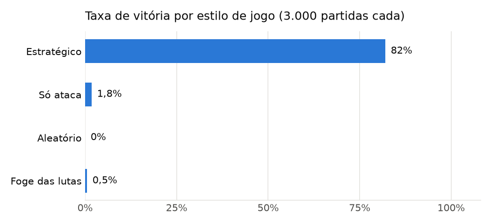
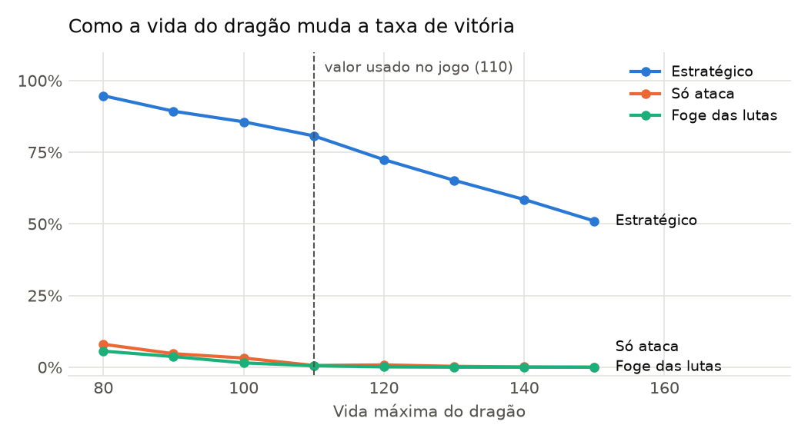

# ⚔ Masmorra de Pedra

RPG de fantasia medieval jogado no terminal, feito em **Python 3.13** com a biblioteca [rich](https://github.com/Textualize/rich).
O herói desce 5 andares de uma masmorra, escolhendo entre portas, lutando contra monstros, comprando equipamentos e, no fim, enfrentando o **Dragão Ancestral**.

O diferencial do projeto é que **a dificuldade foi calibrada com dados**: um simulador joga milhares de partidas sozinho, com estilos de jogo diferentes, e os atributos dos monstros foram escolhidos a partir desses resultados.



## Como jogar

```bash
python -m venv .venv
.venv\Scripts\activate        # no Linux/macOS: source .venv/bin/activate
pip install -r requirements.txt
python main.py
```

**Mecânicas principais**

- **Combate por turnos:** atacar, defender ou usar poção. Os golpes têm variação e 10% de chance de crítico.
- **Golpe pesado anunciado:** o inimigo avisa um turno antes. Defender nesse momento bloqueia 75% do dano.
- **Evolução:** XP, subida de nível e atributos que crescem.
- **Ouro e loja:** poções, armas e armaduras que somam no ataque e na defesa.
- **Exploração:** cada andar tem duas portas. Uma leva a um monstro; a outra é uma surpresa (tesouro, fonte, loja ou armadilha). Tesouro e armadilha têm a mesma pista.
- **Chefe final:** o dragão tem um sopro de fogo de dano triplo e entra em fúria na metade da vida.



## Balanceamento com dados

O script [`ferramentas/simular.py`](ferramentas/simular.py) usa **as mesmas regras do jogo**, mas troca o jogador por estilos automáticos:

| Estilo | Como joga |
|---|---|
| Estratégico | Luta quando a vida está acima da metade, defende do golpe pesado, usa poção abaixo de 40% e compra equipamentos |
| Só ataca | Sempre luta e só ataca, mas compra equipamentos |
| Aleatório | Escolhe portas e ações ao acaso e não compra nada |
| Foge das lutas | Evita todos os monstros dos andares |



O objetivo era que **jogar bem fizesse diferença**: quem joga com estratégia vence cerca de 82% das partidas, e quem joga no automático quase nunca vence. Para escolher a vida do dragão, o simulador testou valores de 80 a 150:



| Vida do dragão | 80 | 90 | 100 | **110** | 120 | 130 | 140 | 150 |
|---|---|---|---|---|---|---|---|---|
| Estratégico | 95% | 89% | 86% | **81%** | 72% | 65% | 58% | 51% |

O valor 110 mantém o dragão desafiador sem frustrar quem joga bem.

Para gerar os gráficos de novo:

```bash
pip install -r requirements-dev.txt
python -m ferramentas.simular
```

## Arquitetura

As **regras** não usam `print` nem `input`: elas só calculam e devolvem resultados. A **interface** cuida da tela. Essa separação permite testar as regras e rodar o simulador sem precisar de um jogador.

```
main.py                    fluxo da partida: liga regras e tela
rpg/
  personagem.py            Personagem, Heroi, Inimigo, XP e níveis; monstros descritos como dados
  combate.py               regras do turno, golpe pesado, fúria e estatísticas
  itens.py                 catálogo da loja e regra de compra
  mundo.py                 geração aleatória dos andares e efeitos das salas
  interface.py             tudo que aparece na tela (rich)
ferramentas/
  simular.py               simulação de balanceamento e gráficos (matplotlib)
  capturar_tela.py         gera as imagens SVG das telas
tests/                     55 testes automáticos (pytest)
```

**Decisões que valem destacar**

- **Monstros como dados:** o dragão é só uma entrada em `MODELOS_INIMIGOS`, com o próprio golpe, multiplicador e fúria. O combate não tem nenhum `if dragao`.
- **Sorteio injetável:** as regras recebem o gerador aleatório (`rng`) como parâmetro. Nos testes entra um "dado viciado" com resultados previsíveis; no simulador entra uma semente fixa, o que deixa os resultados reproduzíveis.
- **Herança com sobrescrita:** `ataque_total` e `defesa_total` somam o equipamento no herói, e os inimigos usam a versão básica.

## Testes

```bash
pip install -r requirements-dev.txt
python -m pytest
```

## Roteiro do desenvolvimento

- [x] Etapa 1: combate por turnos
- [x] Etapa 2: XP e níveis
- [x] Etapa 3: ouro, equipamentos e loja
- [x] Etapa 4: exploração com andares, portas e eventos
- [x] Etapa 5: chefe final e telas de vitória e derrota
- [x] Etapa 6: simulador de balanceamento, gráficos e documentação

**Ideias para o futuro:** salvar e carregar partidas em JSON, classes de personagem (guerreiro e mago) e um ranking de partidas.
